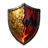

<p align="center">
  
</p>

# Grudgelands

**Choose a faction. Grow into a hero. Build a place to call home.**

Grudgelands is an open-source fantasy RPG for [Luanti](https://www.luanti.org/),
combining MMO-inspired classes, quests and progression with the freedom to
gather, craft and build in a shared voxel world.

Follow your faction's story, develop your talents and team up for dangerous
bosses. Between adventures, improve your equipment, tend your crops and
return to a home you built yourself.

**2 factions · 6 peoples · 4 classes · 390+ quests · Progression to level 60**

**[Play in your browser](https://kaesual.com)** ·
[Join our Luanti server](#play-with-luanti) ·
[Discord](https://discord.gg/M4auM7yunk) · [Changelog](CHANGELOG.md)

> **Playable and actively developed.** Expect rough edges and changing
> balance. Feedback from your adventures helps shape the next update.

## What you can play today

- **Make your character your own.** Join The Accord as a Human, Dwarf or
  Elf, or The Throng as an Orc, Troll or Undead. Play a Warrior, Mage,
  Priest or Scout, shape your abilities through two talent trees per class
  and earn cloaks through achievements.
- **Follow a story across the world.** Start with the people of your home
  town, travel to your capital and follow quests through forests, mountains
  and contested borderlands. Each faction has its own main story, leading
  toward a finale for a small party. Some quests let you choose your
  reward, and your map and quest log help you find the next step.
- **Face greater dangers together.** Form a party to challenge bosses,
  raid enemy war camps or sail to distant dragon islands. Contested lands
  and enemy territory automatically flag you for faction PvP; you can also
  flag yourself elsewhere. Fighting other players requires both sides to
  be flagged.
- **Make the gear for your next adventure.** Choose two of six primary
  professions to craft weapons, armour, bags and jewellery. Improve your
  equipment with enchantments and upgrades, or hunt for better loot.
  Search recipes, see where every ingredient comes from and queue up to
  five crafting jobs that keep progressing while you are offline. Everyone
  starts with Cooking; Alchemy adds potions and elixirs.
- **Build a home between journeys.** From level 20, claim a protected plot
  in your faction's homelands and decide which friends can use it. Build,
  grow crops, go fishing and prepare supplies. Your activated Claim Stone
  connects your home to the waystone network.
- **See more of the world.** Ride from level 15, take a boat across the sea
  or unlock flying mounts at level 45. Explore caves for resources and
  stronger creatures, then return to towns with wandering inhabitants,
  ambient sounds and music in each capital.

The Accord and The Throng have their own reasons to fight. But something
beneath the world is beginning to profit from both sides.

## Play with Luanti

**In your browser:** visit [kaesual.com](https://kaesual.com) to play.

**With the Luanti client:** open **Join Game**, search the public server
list for **Grudgelands**, select the server and register or log in.
The server supplies the game content; you do not need to install this
repository or any client mods to join.

To create a local world or host a server, see
[Your own world or server](#your-own-world-or-server) below.

## Getting started

1. **Create your character:** choose your faction, people, class and look.
2. **Meet your first quest giver:** a yellow `!` means a new quest;
   a yellow `?` means one is ready to hand in. Right-click to talk.
3. **Fight:** your starter weapon is equipped and your class's basic
   attack sits on key 1: select it and left-click a creature, or hold the
   button. Skills you unlock with talents wait in **Talents & Skills** in
   your inventory; drag them onto the hotbar.
4. **Find your way:** press `Z` for **Map & Quests** and select a quest
   to see its targets. Press `E` for the quickbar: mounts, boats, your
   potion belt and Return home.
5. **Set a home at an innkeeper:** Return home brings you back after a
   journey. Death costs no items, money or XP; you respawn at your bound
   innkeeper.

Press `I` for your inventory. Its **Help** tab explains equipment, crafting,
professions, travel and combat, and includes the sound controls.
Around level 10, your starting quests send you on to the next zone, whose
village, outpost and camps offer their quests at once; around level 19
they lead you to your people's capital, its profession trainers and the
first chapter of your faction's story, which goes on in the zones of
levels 21–40 and leads you to your faction's fortress at 40; from 41 your
Warmaster's main line carries it across the front to the finale at 60.

## Current state

**0.63.0** gives the 36 mining camps fortified timber walls, canvas tents,
tall mining headframes and faction banners, with matching inventory icons.
It also refreshes inventory and service layouts, adds clearer quest and mail
rows, and limits window scaling to the equivalent Full-HD size. It needs a
map reset for the camp changes; final desktop and web playtest acceptance
is pending.

**0.62.0** reworks the quests of the front, levels 41–60: the hosts and
the capitals' envoys offer their Battlegrounds work from its level, far
fewer of them hunts, with new departures, a Throng island bounty and
potion, armor, weapon and trinket choices as rewards. The main line from
the Warmaster at 41 to the finale at 60 is now your faction's story, with
a closing text at every step. Every bag holds four more slots, and two
capital buildings are fixed. It needed a map reset; characters keep their
level, gear, inventory and quests.

**0.61.1** refreshes the vendor, quest-giver, mail, trainer and other
service windows: vendor offers as compact cards with small icons and
their own Buy button, the quest list beside its text and rewards, and
clearer crafting text; the map and the quest column share the window
half and half. No map reset.

**0.61.0** reworks the quests of levels 31–40: the six contested zones
offer their quests at once from level 30, far fewer of them hunts and
more of them errands and things to do at a place (a sighting frame, a
snare, a shroud bundle, a storm vessel, the mining camps' loading
grounds), with potion, armor and weapon choices as rewards. The story's
third chapter runs from Ashenward March and Bannerbreak Mesa at 34 and
35 to your faction's fortress zone at 40. Each zone's elite leader is an
optional quest for a group; the band plays well alone. It needed a map
reset; characters keep their level, gear, inventory and quests.

**0.60.1** gives every window a new look: translucent panels, clear
buttons, tabs with icons, your faction and level in the header, and the
larger map opened directly with the same tabs; the windows stay readable
in small game windows and at higher GUI scales. No map reset.

**0.60.0** reworks the quests of levels 21–30 and of the six capitals:
the eight zones and the capitals offer their quests at once, far fewer
of them hunts and more of them errands, crafts and things to do at a
place (a signal lantern, snares, a sighting frame, banners, a reading
cord), with potion, armor and weapon choices as rewards. The story's
second chapter runs from the mining camps of Frostbarrow Shelf and
Ossuary Reach at level 24 to the Miner's Guild houses at 29. At your
first capital visit the envoy asks for an elixir you learn to brew at
the Alchemy trainer, and the Alchemy herbs now grow in every level band.
Quest items stay in your bags. It needed a map reset; characters keep
their level, gear, inventory and quests.

**0.59.0** reworks the quests of levels 11–20: each of the six zones
offers 13 quests at once, far fewer of them hunts and more of them
errands, crafts, gathering, a witness to find and things to recover at
the bandit camps, with potion, armor and weapon choices as rewards. At
level 19 every capital's envoy opens the first chapter of the faction's
story with the Miner's Guild leader, who sends you to a spot in the town
at 20. It needed a map reset; characters keep their level, gear,
inventory and quests.

**0.58.0** brings the Miner's Guild of each faction, The Charter of
Stone and The Oathdelvers: mining camps across the land with a lift down
to safe, lit rooms at every ore depth, reputation you earn by trading what
you mine, with ranks, three cloaks and two kinds of mining aids from the
camp vendor (Ore Sense marks a deposit through the rock, Treasure Hunt
hides a miner's remains to dig up), a guild house with a headframe in
every capital, enemy camps under construction to raid and 30 guild
quests. Town fixes make Lethariel's bough stairs, the capital gatehouses
and Silverleaf's terrace stair walkable, set the royal guards beside their
king and put each start town's waystone and mailbox at its centre. It
needed a map reset; characters keep their level, gear, inventory and
quests.

**0.57.0** brings a clearer crafting window and new start zones: queue
up to five crafts, enchants and upgrades that run one after the other,
offline too, open a details page that names where each ingredient comes
from, and mark your favourite recipes; Basic recipes come with your
profession tier. The six start towns offer fewer, broader quests all at
once, and some let you choose your reward, ending in a weapon with two
enchants. Alloys and graded woods are simpler to make, every dye can be
crafted, and vendors no longer sell leather, cloth or bars. You can fly
over the water near a bay's shore, and open-chin helmets are open
underneath too.

**0.56.0** brings the fixes from the big playtest: monsters far below
your level leave you alone, a hit monster calls only the kin around it,
archers walk closer instead of shooting arrows that never arrive, and land
mounts fall and jump like you do without throwing you off after a fall.
You can sell from your second hotbar, every Quartermaster trades with its
whole faction, any class may eat mana food, and items in water float to
the surface. Enchant tooltips name the prefix and the suffix, and the
enchanting station shows what a new enchant replaces. Cloth helmets and
leather ones below tier 6 leave the chin free.

**0.55.0** shows your offhand gear on your character: a Warrior's shield
on the left arm, raised in front of the chest to block and a little bigger
with each tier, a Mage's or Priest's spellbook open in the left hand, and
the Scout's second weapon on the back. Shields and spellbooks have new art
and an icon per tier. The Supporter Cloak, the first cloak with wings, is
granted by a server admin to players who helped shape the game early on.
0.55.1 gives server admins `/prof` to set a player's professions for
testing.

**0.54.0** redraws all armor with real shapes: helmets, shoulder plates,
bracers, skirts and boots stand out from the body, each tier richer than
the last, metal bulkiest, leather layered, cloth smooth. Every piece has
new art and a new icon, skirts swing as you walk, the Character page shows
your armor and weapon, and kings and their guards wear royal armor. Leather
tier 4 is now called Hardened. 0.54.1 makes the particle effects glow in
vivid colours, turns Smite into a small beam of light and lets Meteor and
Censure fall faster.

**0.53.0** brings the new classes: each class starts with its own two or
three skills and gains the rest from two new talent trees per class, drawn
as a map on the Talents & Skills page, each ending in an ultimate from
level 42. Every class has a free basic attack, every skill is instant,
area skills land on the ground under your crosshair after a short warning,
and the Scout shoots without drawing the bow. Your talent points are reset
with the update (the server's host runs the migration tool once). 0.53.1
follows at once: area skills and group heals reach past walls and step
edges, tooltips show each skill's range, a flying mount's minimap shows
where you may not fly, the same trinket can be worn twice, new racials for
Undead, Elves and Dwarves, right-click fruit picking and 36 simpler
icons.

**0.52.0** lets the background sounds follow the landscape and your
height: one bed for every temperate forest, new beds for the badlands,
the swamp, the crags, the snowy crags and the Battlegrounds, night
choruses, a soft wind only high up, a quiet bed in real caves and
silence in the tunnels you dig, and animals calling now and then. It also
lays the groundwork for the class update: the skill row scrolls, most
skill icons are redrawn and the selected skill shows a small glow on your
weapon; 0.52.1 adds the surf at the coast and a sound under water.

**0.51.0** brought the land zones and the sea: a larger sea with a wide
coastal belt, natural bays and shallow dragon channels, coral, kelp and
seagrass on the seabed, shipwrecks, and tortoises, frogs, stingrays,
sharks and gobies by water depth, with the sea coloured by depth on the
map, and a few characteristic changes in every land zone (calm grounds,
new plants, ruins, graveyards, cairns, statues and varied bones). It
needed a map reset; characters keep their level, gear, inventory and
quests.

Read the [changelog](CHANGELOG.md) for changes and upgrade requirements,
and the [project status](docs/STATUS.md) for delivery and playtest progress.

**What I want to improve next:** the new classes need a first playtest and
a balance pass, and leveling needs more meaningful choices. I'm working
toward stronger class identities and better group and PvP balance, richer
sound and scenery, more varied and useful crafting, and quests that teach
the game more naturally. These are the next priorities;
the [roadmap](ROADMAP.md#next-priorities--deepening-the-playable-game) has the
direction and planned follow-up work.

## Feedback and contributions

Try a class, follow a few quests or explore with a friend. Tell us what
made you want to keep playing and where you got stuck.
Join the **[Grudgelands Discord](https://discord.gg/M4auM7yunk)** for
questions, stories, ideas and feedback.

For a bug, open a [GitHub issue](https://github.com/Kaesual/grudgelands/issues)
with what you were doing, the version shown in **Help → About** and whether
you used the browser or a native Luanti client. For a local checkout,
include the commit too.

Code, artwork, sound and design feedback are welcome. For a larger change,
start with a discussion and check the [design documents](docs/design/README.md)
and [backlog](BACKLOG.md).

## The person and tools behind it

I'm Jan, the designer behind Grudgelands. I use AI extensively for development
and some artwork, and guide the game through hands-on design, playtesting
and review. Making sandbox freedom and RPG progression work together takes
many small decisions and experiments. Player feedback helps me decide what
to improve next.

## Your own world or server

Grudgelands is a standalone game with its dependencies bundled. For local
play and hosting, it is tested with Luanti **5.17.0**; older versions are
untested.

<details>
<summary>Create a world, configure a server or update an existing world</summary>

For a local world, place this repository in your Luanti `games/` directory
as `grudgelands`, then select it when creating a **new world**. The game
uses mapgen **v7** and brings its own map settings.

> **Keep the map generator settings at their defaults.** The game's world
> generator accepts only its own values and stops the world from loading
> with an error otherwise. The New World dialog hides the map generator
> checkboxes for this game, but it still writes the flags saved in your
> Luanti settings: if you ever changed `mg_flags` (Caves, Dungeons,
> Decorations, Biomes, Ores, Light), set them back to their defaults first. It is
> in Luanti's settings with *Show advanced settings* ticked, on the page
> *Mapgen* ("Mapgen flags"); the reset button beside a changed setting
> restores its default. The v7 flags (`mgv7_spflags`) the game sets
> itself. Do not set `chunksize`,
> `water_level`, `mapgen_limit`, `mgv7_dungeon_ymin`, `mgv7_dungeon_ymax`
> or `num_emerge_threads` in your own `minetest.conf` either; none of them
> is in the dialog.

**The first start of a new world takes a while.** The game prepares the six
starting areas before anyone can enter: a little over a minute from the
server's start on a desktop PC (66 s, measured headless, 2026-10-16). A window
shows the progress and the time left; you may disconnect and come back
later. Later starts of the same world are much faster.

**Hosting a server.** The game's settings are in Luanti's settings menu
under *Content: Games → Grudgelands*. The ones that matter most: the world map
quality (normal or high), *Prepare full world before entry* (off by
default; on, the first start prepares the whole world and takes several
hours), the damage multiplier for creatures and NPCs (1.5 by default), the
particle amount of the combat effects (1.0 by default, the same for every
player) and tree regrowth. Damage is always on and creative mode is off. Details:
[world preparation](docs/design/world_preparation.md).

**Updating a hosted world.** Each [changelog](CHANGELOG.md) entry says
whether an existing world plays on, needs a map reset, a migration or a
new server. A migration runs offline with the tool that comes with the
game, from the root of the new version's repository checkout (Python 3.13
or newer; a PostgreSQL world also needs psycopg 3, Debian's
`python3-psycopg`):

1. Stop the server. The tool cannot tell whether a server is running.
2. Back up the world: its directory and, for PostgreSQL, its databases.
3. `python3 tools/migrate.py --world <world directory> --check` shows the
   world's version and the due steps and changes nothing.
4. `python3 tools/migrate.py --world <world directory>` runs the due steps.
5. Start the server with the new version.

Exit code `0`: migrated, or nothing to do. `2`: refused before anything was
written, so the world is unchanged; the last line on standard output says
why. `1`: it failed while writing: restore the backup. A server refuses to
start a world that still needs the tool, and names the command. Details:
[the migration tool](tools/README.md#the-migration-tool) and the
[upgrade contract](docs/technical/upgrade-contract.md#5-migrations).

</details>

<details>
<summary>Local development setup</summary>

For the Flatpak installation used in development, run this from the repository
root to copy the game into Luanti's game directory:

```sh
tools/sync_to_luanti.sh
```

For source-based development, also fetch the pinned reference projects:

```sh
git submodule update --init --recursive --depth 1
```

These reference checkouts are for development only; playing does not require
them. Contributors start with the [project conventions](AGENTS.md) and the
[reference-project guide](docs/reference_projects.md).

</details>

## Built on community work

Grudgelands would not be possible without Luanti and the people who have
spent years building its games, mods and tools. Their care, creativity and
shared knowledge are a large part of its foundation. The project draws on
both reference implementations and openly licensed code and artwork from
projects such as Minetest Game, VoxeLibre, Lord of the Test,
Mobs Redo, Animalia, Animal World and many others.

The [reference-project list](docs/reference_projects.md) links to the projects
we study; [VENDOR.md](VENDOR.md) records the code we ship and our changes.
[CREDITS.md](CREDITS.md) thanks the composers, sound designers and artists
whose work the game uses; media authors, sources and licenses are documented
alongside the assets in per-mod license files.

## Support development

If you enjoy Grudgelands and would like to support its continued development,
you can **[buy me a coffee](https://buymeacoffee.com/kaesual)**. Thank you for
playing, sharing feedback or helping in whatever way suits you.

## Explore the design

The [design index](docs/design/README.md) contains the decided game rules; the
[documentation guide](docs/README.md) explains where everything else lives.
Some describe systems still being built; the [backlog](BACKLOG.md) tracks
implementation, and [research notes](docs/research/) retain the supporting
investigations and delivery records.

<details>
<summary>Browse the game design</summary>

| Area | Design documents |
|------|------------------|
| World and places | [World](docs/design/world.md): geography and world rules; [zones](docs/design/world_zones.md): regions and level ranges; [settlements](docs/design/settlements.md): towns, capitals and fortified mining camps; [story](docs/design/story.md): factions and the campaign. |
| Characters and combat | [Classes](docs/design/classes.md): abilities and resources; [targeting](docs/design/ability_targeting.md): how skills pick their targets and areas; [Scout](docs/design/scout.md): bow and blade; [combat](docs/design/combat_stats.md): damage and defenses; [PvP](docs/design/pvp.md): the PvP flag, fortresses and war camps; [visuals](docs/design/character_visuals.md): peoples, equipment appearance, cloaks and achievements. |
| Progression and quests | [Progression](docs/design/progression.md): levels and rewards; [talents](docs/design/skill_trees.md): character builds; [quests](docs/design/quests.md): objectives, journal and credit; [Miner's Guild](docs/design/miners_guild.md): mining camps, lifts, reputation and the guild's goods. |
| Items and crafting | [Items](docs/design/items_crafting.md): materials and recipes; [item tiers](docs/design/item_tiers.md): enchant values, upgrades, the crown, potions and drop prices; [professions](docs/design/professions.md): trades, station recipes and production; [enchanting](docs/design/items_crafting.md#6b-enchantments): enchantments and their inputs; [equipment](docs/design/inventory_equipment.md): slots, bags, crafting stations and the approved UI presentation rules; [durability](docs/design/durability_repair.md): wear and repair; [economy](docs/design/economy.md): money, prices and services. |
| Wildlife and everyday life | [Biomes and mobs](docs/design/biomes_mobs.md): habitats and creatures; [spawn regions](docs/design/spawn_regions.md): where each zone's creatures live and at which level; [farming](docs/design/farming.md): crops; [housing](docs/design/housing.md): Claim Stone homes. |
| Travel and playing together | [Mounts](docs/design/mounts.md): riding; [boats](docs/design/boats.md): water travel and the way to the dragon islands; [home travel](docs/design/home_travel.md): innkeepers and return; [parties](docs/design/parties.md): playing in a party; [mail](docs/design/mail.md): mailboxes, letters and messages to the admin; [atlas](docs/design/world_map.md): maps, minimap and markers. |
| Sound | [Sound](docs/design/sound.md): effects, creature voices, ambience, music and the sound settings. |
| Hosting | [World preparation](docs/design/world_preparation.md): generating starting areas or the full world. |

</details>

## License

Grudgelands' own code is **GPL-3.0-or-later** ([LICENSE.txt](LICENSE.txt)).
The combined game is **GPL-3.0-only** because it includes GPL-3.0-only code
from cottages; see the [license overview](docs/research/licensing.md).

Media retain their individual licenses, documented per mod: CC0, CC BY,
CC BY-SA or GPL, as applicable. The
[Grudgelands crest](menu/LICENSE-media.md) is CC0.
