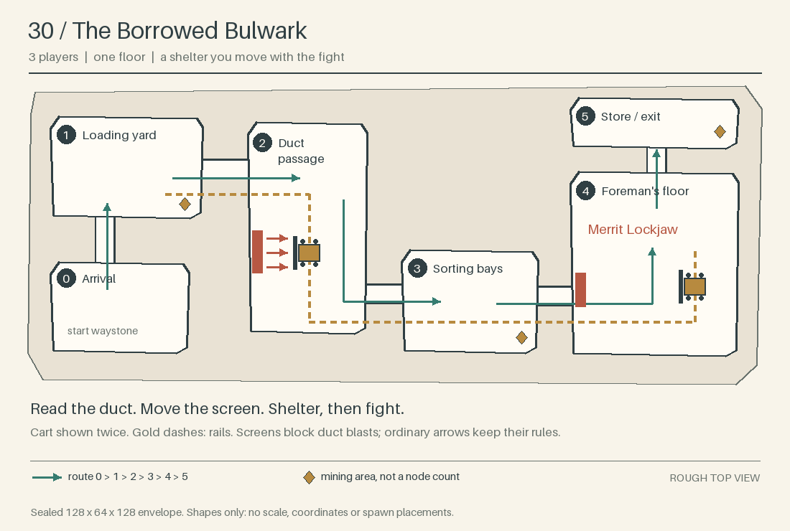
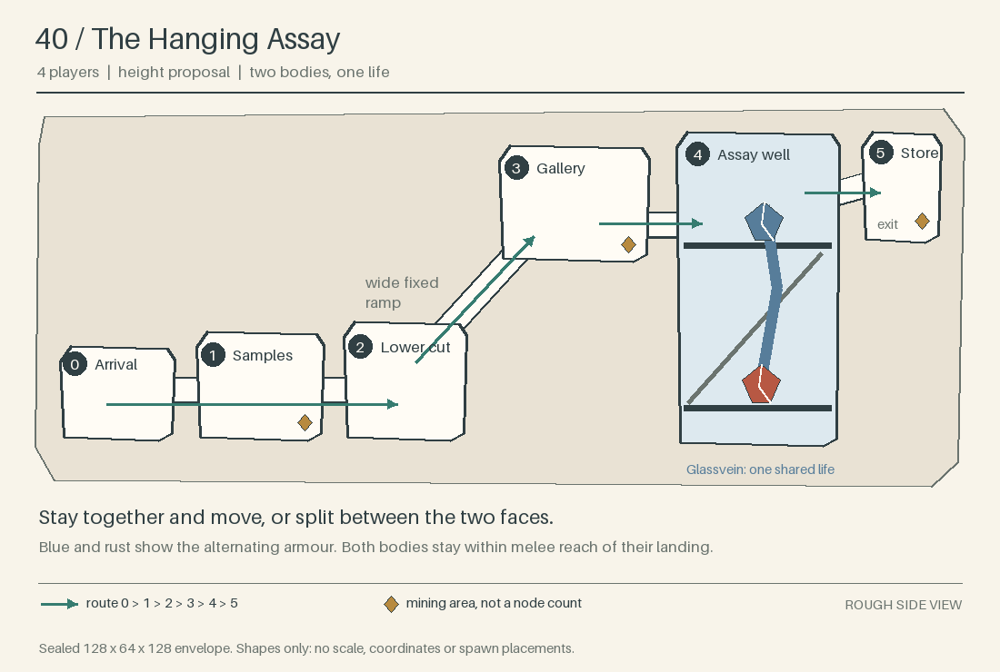
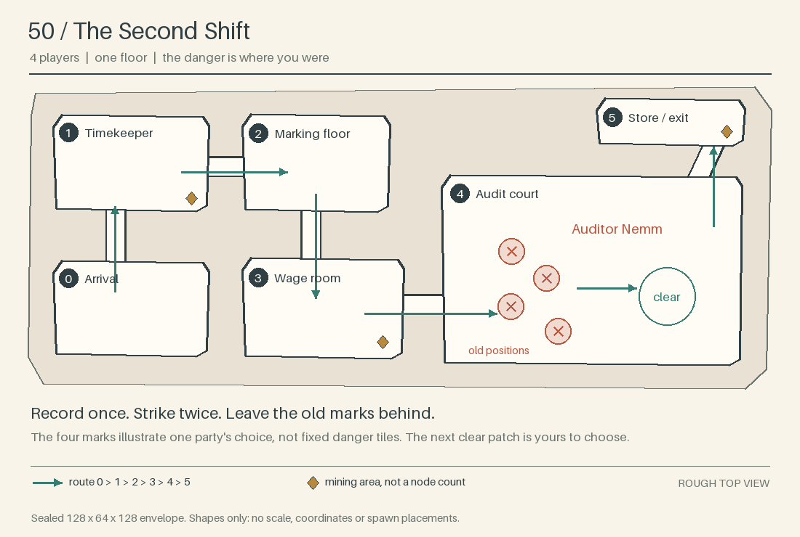
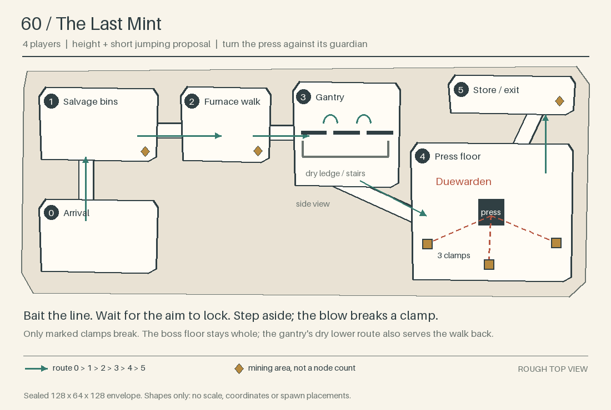

# Four more Expeditions — Round 71 outline

**Proposals for the user's selection, 2026-11-07.** These are game ideas, not
approved design or a build plan. **Compatible:** this lane adds only prose,
sketches and their generator; independent review belongs to the coordinator
before integration.

## The shared frame

The [concept](round71-expeditions-concept.md) governs every proposal. Each aims
for **15 minutes within 10–20**, roughly four ordinary packs and one boss, at
its stated party size throughout **level +0 to +9**. Fewer players may enter;
the fights do not shrink. Every Expedition needs a tank and a healer (concept §2); the other jobs below are
freely assigned.
Mobs and chest rewards use the chosen level. Family names below describe the
roster; only bosses keep their fixed name across levels.

Every route is linear, inside a sealed **128 × 64 × 128** box under the sea.
No building, riding or flying; the hull cannot break. Only ore, gems and the
explicit press clamps below are destructible. A pack pulls whole and pursues
until its targets die or leave; death returns to the safe start waystone.
A wipe restores the unfinished pack, including its mechanic; fully cleared
packs stay dead. Cleared return paths stay open during the boss fight.

Each boss opens a store with a **personal chest inventory for every eligible
player**, richer shared mining and the end waystone. Sparse nodes appear only
after the first pack. Ore stays at the Expedition's harvest tier even at +9;
neither mobs nor chests supply ore or gems. Every optional quest is **free**,
has **no `story` flag or prerequisite**, and asks only to kill its boss.
Level 60 follows the same rule; repeat visits need no quest or guild rank.

The [guild](../design/miners_guild.md) remains an honest ally of its faction.
[The Stilled Seam](round71-l20-description.md) remains a local accident:
**accident → stolen equipment → branded pay → bound names → a supply source**
is a widening discovery, not a claim that one villain caused all five.
The factions pursue each case independently. None requires or replaces the
[main story](../design/story.md), including its final confrontation.

Costs are relative estimates beyond the basic Round 71 framework. **Small**
means arrangement or a modest variation; **medium** a new encounter behaviour;
**large** a new shared system. Existing assets are not working mechanics.
All cues must work silently on standard desktop and web clients: visible
shapes, generous wind-ups and server decisions, with particles in the hundreds
at most. No new sound is assumed.

## 30 · The Borrowed Bulwark

**3 players · levels 30–39 · one main floor**

**The idea.** You steal back a mine's safety cart and move your shelter through
the fighting. At the last sorting floor, the smugglers' overseer turns the dust ducts on
you, and the cart he stole keeps you alive.

**Story.** A contractor sold the crew's safety equipment to armed smugglers;
the stopped mine is their loading yard. The Charter of Stone, for **The
Accord**, wants its workers protected before deliveries resume. The Oathdelvers,
for **The Throng**, demand back the equipment entrusted to their crew.
Altered receipts suggest buyers beyond this mine, but carry no Tithe-Brand.
This extends the guild's ordinary supply work without making it complicit.

**Mechanics and roles.** Use the brake lever to move an indestructible cart
between marked rail stops; nobody rides or pushes it continuously. A broad screen
on it blocks **signalled dust blasts from wall ducts**, not ordinary arrows.
Read the opening duct, put the screen between it and the party, then leave
shelter to fight between blasts. Stops leave room to pass on foot.
The front fighter keeps enemies away from the brake; ranged players clear
the far edge; the third player moves the cart and helps either side. Anyone
can take the brake.

**Route.** Arrival → loading yard (first pack; reclaim cart) → duct passage
(learn shelter) → sorting bays (shelter and enemies together) → foreman's
floor → store. The rail never blocks the walk back.

**Boss: Merrit Lockjaw**, the smugglers' overseer, a bandit. He fights beside the cart while
opening alternating ducts. The party chooses the useful stop, shelters for
the burst and comes out to hit him; he stays damageable throughout. Use
existing bandit melee and archer families for the mine's packs.

**Ore.** Harvest **T3: Silver and Garnet**, in cleared wall cuts and the store.

| Mechanic | Existing basis | New work | Simpler fallback |
|---|---|---|---|
| Movable shelter | Decorative mine cart and rails; interactions | **Large:** guided movement, shelter checks, safe passage around it | Fixed screens beside each duct; keep the shelter timing. The cart, and with it the idea above, goes. |
| Duct blasts and boss rhythm | Bandits; attack warning patterns | **Medium**, plus the shared room clock below: visible duct warnings, damage with no mob behind it, boss timing; current projectiles do not check cover | One marked blast strip at a time, with a permanent safe edge. |
| Stolen equipment's look | Mine props and bandit bodies | **Small:** screen added to cart; optional foreman's texture | Ordinary cart beside existing timber screens. |

## 40 · The Hanging Assay

**4 players · levels 40–49 · height proposal: two galleries and a wide ramp**

**The idea.** The crystal on one gallery and the crystal above it are the same
creature. Its armour passes between the two bodies, and your party decides
whether to split across the galleries or chase the exposed face together.

**Story.** An assay crew uncovered a living crystal growth beneath a
contractor's abandoned store. Heat from farther below has woken it. Among the
stored battlefield pay is the first unmistakable **Tithe-Brand**, the broken
circle with two hooks. For **The Accord**, The Charter of Stone traces the
consignment's false receipt; for **The Throng**, The Oathdelvers identify the
crew whose promised wages never arrived. The mark is evidence, not proof of
either faction's guilt; examining it is not accepting branded pay.

**Mechanics and roles.** Both galleries remain reachable by a broad permanent
ramp, about one room's height apart. Glowing cracks show the softer body;
the other takes reduced damage, never none. One body attacks while the other
braces. On a fixed, warned beat they exchange armour and duties, with time to
move. Front fighters face the active body; ranged fighters follow the exposed
face; support holds the ramp's clear view; a fourth player helps either landing.
These are jobs, not a two-tank or ranged-class requirement.

**Route.** Arrival → sample room (first crystal pack) → lower cut (fight
round rock ribs) → rising gallery (see the growth connecting both floors) → assay
well → sealed store. Use existing Crystal Shard and Oerkki families.

**Boss: Glassvein.** Two Crystal Shard bodies share one life and one kill.
The thick crystal trunk between them makes that relationship visible. Both
are within melee reach from their landing; neither gallery disappears.
Splitting saves travel; staying together makes recovery and support easier.

**Ore.** Harvest **T4: Emberglass and Sapphire**, at landing edges after the
first pack and in the store; never on a dangerous drop.

| Mechanic | Existing basis | New work | Simpler fallback |
|---|---|---|---|
| Two galleries | Walking, ramps, 3D templates | **Small:** readable sightlines and a short return route | A horseshoe gallery on one floor. |
| One boss in two bodies | Crystal Shard body and attacks; single-boss rewards | **Large:** shared life, alternating attacks, one defeat and wipe state, an exception so the pack rule leaves a body on its landing | One body blinks between two landings on a warned beat. |
| Passing armour | Existing attack cues and textures | **Medium:** linked vulnerability cue and damage change; **small** optional cracked skin | Single body exposes cracks after each slam. |

## 50 · The Second Shift

**4 players · levels 50–59 · one main floor**

**The idea.** The mine remembers where you stood and strikes those places a
few seconds later. In the final fight it strikes the same record twice, so
stepping back onto the spot that was just hit is the mistake.

**Story.** The guild has received wages addressed to miners already dead.
Below the payroll room, skeletons still work a shift with no ending. This
local ledger gives no creditor's name, only the rule: accepting branded wages
binds a name, and death does not discharge the debt. For **The Accord**, The Charter
of Stone separates the dead workers' names from a fraudulent payroll. For
**The Throng**, The Oathdelvers recover names sold as if an oath belonged to
the paymaster. These are particular victims, not the origin of all undead.

**Mechanics and roles.** A stamping gesture records each player's position
once. Broad floor outlines stay there for several seconds before the blow;
they never chase anyone. Keep an escape lane, move out, keep fighting.
Front fighters lead the enemy away from the marks; ranged fighters place
their marks where others need not cross them; support and the fourth player
keep the next clear patch usable. Marks from the same beat do not stack
damage. Only one recorded set exists at a time, at most four marks.

**Route.** Arrival → timekeeper's desk (first pack) → marking floor (one
recorded blow) → wage room (the same lesson under pack pressure) → audit
court → store. Use existing Skeleton Raiders and Archers, who shoot and strike only up close, with Buried Miners (zombies) as the melee fighters.

**Boss: Auditor Nemm**, a skeleton with the payroll chained to its ribs.
Nemm repeats each recorded blow **twice**, with a fresh warning before the
second. The old marks remain visible until both blows finish, then clear.
Players choose the next safe part of the court themselves; no ability is
copied and no class is punished for healing. Killing Nemm stops the payments;
the guild then closes the false payroll. Its death is the only quest
objective.

**Ore.** Harvest **T5: Abyssal Crystal and Ruby**, in cleared side niches and
the store. The workrooms remain spacious enough to place marks safely.

| Mechanic | Existing basis | New work | Simpler fallback |
|---|---|---|---|
| Recorded positions | Player positions; warned area attacks | **Medium:** snapshots, persistent outlines, delayed hits and clearing on a wipe | Warn one of three fixed floor areas instead. |
| The second blow | Same recorded set and skeleton combat | **Small** beyond recording: replay with another warning and shared damage limit | One blow per record throughout. |
| Payroll-bound workers | Skeleton bodies and mine furniture | **Small:** optional ledger-and-chain skin for Nemm | Existing skeleton appearance beside a chained ledger prop. |

## 60 · The Last Mint

**4 players · levels 60–69 · height and short jump-and-run proposal**

**The idea.** A buried hot press burns the Tithe-Brand into stolen battlefield
pay. You trick its guardian into breaking the press's own clamps, until the
machine that paid the dead can no longer protect it.

**Story.** A salvage crew followed the marked consignments to one hidden
branding workshop. For **The Accord**, The Charter of Stone separates recovered
pay and personal belongings from this war supply. For **The Throng**, The
Oathdelvers cut off the buying of fresh names. The press brands stolen coin;
ordinary money remains ordinary. This closes the guild's local investigation,
whether played before or after the main story's ending. It destroys one
supply operation, not the Undertithe, and opens no path into the Nether.

**Mechanics and roles.** The guardian aims a heavy press arm at the farthest
player on the press floor, marking a straight strip. Stand with one of
**three marked clamps** behind you; once the aim locks, step aside.
Its blow breaks that clamp and removes part
of its armour. A miss costs time, never the run. The front fighter holds the
guardian near a useful line; a freely chosen bait player aims the strike;
ranged and support players keep that strip clear and attack between blows.
No pick, spell or special class is needed to break a clamp.

**Route.** Arrival → salvage bins (first pack) → furnace walk (see a warned
press stroke beyond a safety grate) → broken gantry (cross above the machinery)
→ press floor → store. Use existing Lava Seep, Ember Wisp and Bedrock
Sentinel families. The gantry has **two short, broad jumps outside combat**,
with a dry catch ledge and stairs onward. This lower walkway also gives a
safe return without jumping. Lava stays below fixed grates; the boss floor
stays solid.

**Boss: Duewarden**, a Bedrock Sentinel guarding the press. All three clamps
must break to strip its protection; ordinary attacks then finish it. Each
success changes the machine visibly. No endless adds or arena collapse.

**Ore.** Harvest **T6: Diamond only**, in safe cuts beyond the bins and the
store. Level 61+ equipment does not change the mining tier.

| Mechanic | Existing basis | New work | Simpler fallback |
|---|---|---|---|
| Aimed press and breakable clamps | Sentinel body, the elite wind-up's frozen aim, named template places | **Large** with a moving arm: aimed machinery, authored break targets, armour stages and wipe restoration. **Medium** if the strip runs from the guardian on the existing wind-up and the press stands still | Three fixed stamp plates; a baited blow on each removes a ward, with no moving arm or broken geometry. |
| Short gantry crossing | Ordinary jumping and static stairs | **Small:** safe catch ledge and walking return | A continuous bent gantry; keep the height. |
| Lava below the grates | Template nodes | **Small:** a sealed basin; lava flows inside a box, and the lane proof covered water only | Glowing rock instead of lava. |
| Branded press and guardian | Existing stone, metal and Sentinel assets | **Small:** optional branded skin; **medium** moving press model included above | Static block-built press and a floor warning. |

## What the framework must learn

Sizes count once, for the first Expedition that needs the piece.

- **Visible encounter cues (medium):** persistent floor shapes and machine states,
  readable without sound, particle clouds or quick client reactions. Particles
  live 3 seconds at most, so marks that stay are new entities or nodes.
- **Room clock (medium, only for The Borrowed Bulwark's ducts):** a timed hazard
  no mob owns, scaled to the run's level, silent when nobody is near.
- **Room state on a wipe (small, each reset counted above):** a wipe event the
  mechanics can hear, which restores the active pack's starting state for its
  hazards, cart, clamps and boss; preserve cleared packs and their open return.
- **Guided movable props:** player-operated carts between marked stops,
  with safe passage around them.
- **Specific environmental hits:** dust checked against a shelter, a recorded
  floor hit, or a press hitting its authored clamp; no general terrain damage.
- **Optional linked bodies:** one life, attack rhythm, boss credit and reward
  event across two entities, only if The Hanging Assay is selected.
- **Readable height:** broad routes, reach from ordinary attacks, safe falls
  and open returns. No new movement ability or client feature.

**My ranking:** **1. The Second Shift** — the party writes its own danger,
with modest machinery and a strong story fit. **2. The Borrowed Bulwark** —
a useful object changes how the group moves through the whole mine.
**3. The Last Mint** — the strongest ending image, but the press deserves a
prototype before committing to its full look. **4. The Hanging Assay** —
the clearest use of height, with the highest risk of shared-boss complexity
and camera confusion. Its simpler version loses more of its identity.

## Open choices and recommendation

- **Reveal pace:** recommend the first direct Tithe-Brand at 40, the rule of the debt
  at 50 and the name Undertithe at 60. Keep every explanation local and self-contained so these
  quests remain optional in any order.
- **Scope:** recommend pursuing the recorded positions first: a medium and two
  smalls. The cart comes next, but it is the largest job here, a large beside a
  medium and the room clock. Test the press idea in its cheaper form, and retain
  the two-body creature as the ambitious option. These are selections for later work, not implementation approval.
- **Jumping:** recommend trying the forgiving gantry only at 60. If ordinary
  desktop or web movement makes it awkward, use the continuous walkway.
- **Clamps:** the concept names two destructible things, a story tunnel and ore
  and gems. Clamps would be a third: only the boss's blow breaks them, no player
  can dig them. Recommend allowing it.

## Grounding and sketches

Lore follows the [story bible](round36/story-bible.md); roles follow the
[class rules](../design/classes.md). Enemy families and depths follow
[biomes and mobs](../design/biomes_mobs.md) and
[world zones](../design/world_zones.md). Resource tiers follow
[item tiers](../design/item_tiers.md) and the
[harvest registry](../../mods/ITEMS/grug_materials/registry.lua).
The [existing cart](../../mods/MAPGEN/grug_mapgen/world_nodes.lua) is static;
the [current encounter code](../../mods/PLAYER/grug_expeditions/encounters.lua)
does not supply these new boss mechanics.

The sketches show shapes and routes, **not scale, node counts or spawn
placements**. Reproduce them with
`python3 tools/r71_outline/sketch.py`; check the committed images with
`python3 tools/r71_outline/sketch.py --check`.
