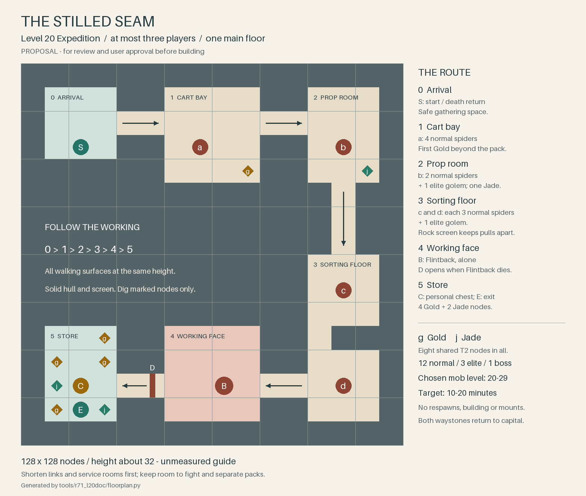

# The Stilled Seam — level 20 Expedition

**Draft for approval, 2026-11-07.** Opus-reviewed; the user approves it
before L20 builds it. Bound by the [concept](round71-expeditions-concept.md).
**Compatible:** documentation and drawing tool only; no game changes.

## Story and place

Each Miner's Guild followed the same gold seam into a pocket of living stone.
Golems broke the timber supports, and spiders spread into the abandoned
workrooms. The crew escaped and sealed the survey cuts. **Flintback**, the
golem that drove them out, still holds the last working face. The guild
needs fighters to make a return possible.

The underground mine has timber props, sorting benches and abandoned carts.
Hard bedrock surrounds it; digging round the occupied rooms would cut
through the remaining roof supports. Entry is through the arrival waystone;
the sealed cuts stay scenery. No destructible tunnel is needed.

For **The Accord**, The Charter of Stone must honour its supply contracts
without spending another crew. For **The Throng**, The Oathdelvers must keep
their promise to the goldsmiths and to their own crew. Guild markings and quest
voice differ; layout, enemies and rewards are identical. Each faction acts
independently: the two guilds work the same seam from opposite ends, and
neither text mentions the other. Beside the capital story at 19–20, this shows the guild
protecting its workers; no chapter prerequisite or early Undertithe reveal.

## Route and encounters

One continuous floor, **0 → 1 → 2 → 3 → 4 → 5**, for **at most three players,
10–20 minutes**. Fewer may enter, solo included; the fights stay balanced for
three, the level 20 cap of the concept's 3–4. Unmeasured target: 15 minutes, roughly 8 for the four
packs, 3 for Flintback and 4 for walking, recovery and rewards.

Use the existing **spider and golem families**, both present underground at
level 20: Crevice Spider and Stone Golem as roster references. Shown names
may follow the level band; only **Flintback** keeps a fixed name. Every mob
and the boss uses the selected level **20–29**. Keep pack sizes, space and
attack cues; tune combat for three players throughout, including +9.
Every mob's gear and materials use its selected level too. Golems and Flintback
drop no ore or gems here: their usual Iron Lump and Rough Citrine rows go, so the
marked nodes stay the only source.

| Room | What waits there | What the players do |
|---|---|---|
| **0 · Arrival** | Start waystone; no mobs or resources. | Gather safely before entering the cart bay. |
| **1 · Cart bay** | Pack **a**: 4 normal spiders. One Gold node beyond them. | Focus a target together; the spiders' slowing bites discourage scattering. |
| **2 · Prop room** | Pack **b**: 2 normal spiders and 1 elite golem. One Jade node at the far wall. | Clear the spiders, then dodge the golem's thrown rocks and step aside from its frontal slam. |
| **3 · Sorting floor** | Packs **c** and **d**, each 3 normal spiders and 1 elite golem. A solid rock screen separates them. | Take one pack at a time; regroup before rounding the screen. |
| **4 · Working face** | **Flintback**, one elite boss, alone. | Fight in an open court; its death opens the reward door. |
| **5 · Store** | Personal reward chest, six resource nodes and end waystone. No mobs. | Loot, share the mining and return to the capital. |

Total: **12 normal spiders, 3 elite golems and 1 boss**. Separate the packs
so they can be fought individually. Mobs never respawn. Death returns
players to room 0 with Round 70's penalty; the cleared walk back stays open
during the boss fight. No building, mounts, flying or block-placement puzzle.
Only marked ore and gems can be dug; all other geometry is indestructible.

**Flintback** is the living rock the miners first mistook for the seam's
back wall. It reuses the stone golem's body and attacks: thrown rocks and
a signalled frontal slam. Spread out, step aside during the wind-up and
circle it. No adds, phases, required class ability or new mob look.

## Ore and rewards

Propose **eight shared nodes per run**, all harvest T2: one Gold after pack
a, one Jade after pack b, then four Gold and two Jade in the store. Each
is exposed at floor reach with solid hull behind it. They stay T2 at +9.
Mining is optional and needs the appropriate pick.

The only store entrance is the door behind Flintback; it opens on its
death. The chest has a **separate inventory per player**: equipment, Bags
of Coins and non-ore, non-gem crafting materials from this Expedition's
loot table at the chosen level. Both waystones return players to their
departure capital; Return Home works normally. Entry and loot need no quest.

## Optional quest: Party: The Stilled Seam

**Level 20**, available from 18; one shared quest, completed once. No
prerequisite, follow-up or `story` flag; mark it as a group quest.
**Objective: Kill Flintback (1).** Any selected Expedition level counts.
Proposed reward: level-20 XP and copper, weight 4; no reputation or essential
progression reward. The Expedition remains repeatable after turn-in.

Existing guild leaders give and receive the quest:
Alis Cartwright, Hadrin Beamset or Caelir Veinward for The Accord;
Drava Flintshoulder, Iven Lastshift or Ombali Ropekeeper for The Throng.
Use six capital variants of the same quest with the two faction texts
below; return to the giver. The registrar arranges entry. No new town place
or quest object. Each text block is replaceable whole.

**The Accord — offer**

> The Charter of Stone opened a gold seam and struck living stone. Flintback drove the crew out; everyone is accounted for, but the working is closed. Speak to this guild house's registrar for The Stilled Seam Expedition and take two companions. Kill Flintback so our miners can work there again.

**The Accord — completion**

> Flintback is dead, and the crew can begin checking the supports. I will keep the working closed until the foreman has inspected it. The smiths can wait another day for their Gold.

**The Throng — offer**

> The Oathdelvers promised a load of Gold, and Flintback drove us off the seam before we could finish it. The crew got out together; I mean to bring them home from the next shift too. Speak to this guild house's registrar for The Stilled Seam Expedition and take two companions. Kill Flintback so we can return to the working.

**The Throng — completion**

> You brought Flintback down and came back to tell it. The foreman will check the supports before the crew returns. We can keep our word to the smiths with everyone still on their feet.

## Floor plan



Unmeasured guide: **about 128 × 128 nodes, height about 32**. All walking
surfaces share one y. The drawing has eight-node passages and a 32 × 32 boss
court. Shrink toward 96 × 96 by shortening links and reducing arrival, cart
bay and store; retain six-node passages, a 24 × 24 boss court and separation
between c and d.

Small grid of the same plan (one cell represents about eight nodes):

<!-- floorplan-grid:start -->
```text
################
#0..##1...##2..#
#..............#
#.S.##.a..##.b.#
######...g##..j#
#############.##
#############.##
#############.##
############3..#
############.c.#
############...#
#5.g##4...##.###
#g.g##....##...#
#jC..D..B....d.#
#gEj##....##...#
################
```
<!-- floorplan-grid:end -->

`#` solid rock, `.` floor; **0–5** rooms; **a–d** packs; **B** Flintback;
**D** reward door; **S/E** start/end waystones; **C** personal chest;
**g/j** one Gold/Jade node each.

Regenerate with `python3 tools/r71_l20doc/floorplan.py` (Python 3 and
Pillow); `--grid` prints the matching text grid.

Grounding: [guild and its voice](../design/miners_guild.md),
[story](../design/story.md), [story bible](round36/story-bible.md),
[quest rules and givers](../design/quests.md),
[mob families and naming](../design/biomes_mobs.md).

## Open decisions and recommendations

- **Story and texts:** approve this local mining accident and existing mob
  looks; keep direct Undertithe clues for later Expeditions.
- **Size and pacing:** start with four packs; measure at 20 and 29 before
  fixing dimensions or stats. Shrink empty travel first.
- **Who opens the chest:** kill credit follows damage and healing, never party
  membership, and a member can enter after the kill. Recommend: everyone of the
  owner who has entered this run opens their own inventory once.
- **A full wipe:** evading heals a mob. Recommend: Flintback resets to full health,
  dead packs stay dead, and the run goes on.
- **Payout:** start with eight nodes and the weight-4 quest. L20 should
  price the chest through the income check and check mob XP at +9 before
  choosing quantities and coin amounts.
