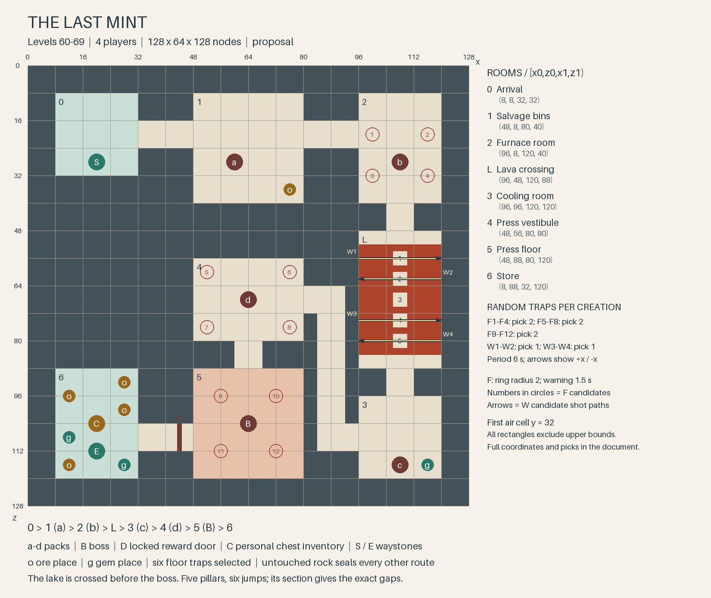
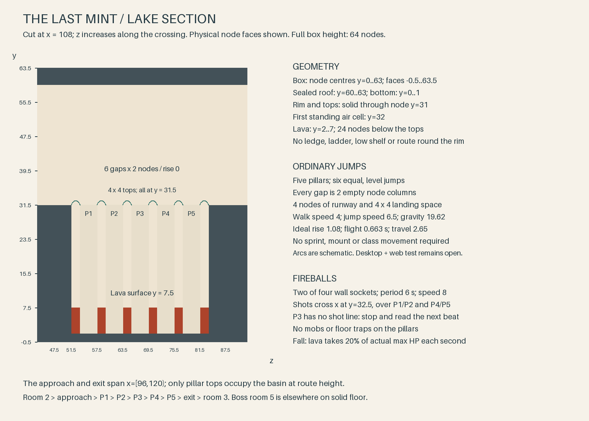

# The Last Mint — levels 60–69 Expedition

**Draft for decision, 2026-11-07; four players.** Build in Round 72 after the
Round 71 GUI test. [Concept §9](round71-expeditions-concept.md#9-after-the-build-three-expeditions-user-2026-11-07)
replaces the safe gantry, press arm and clamps and the older range/tier lines
in the [built rules](../design/expeditions.md). **Compatible:** documents and
drawing tool only. Independent Opus review with whole replacement texts
follows; this draft is not approval to implement.

## Story and place

A salvage crew followed stolen battlefield pay into a buried branding works.
Its furnace is a lava lake; masonry pillars are the only crossing to the
press. The soot factors withdrew, leaving **Duewarden** guarding the machine
that burns the Tithe-Brand into stolen coin.

**The Accord's** Charter of Stone wants the supply stopped and the owners
accounted for. **The Throng's** Oathdelvers mean to stop fresh names being
bought. Each works independently. This is **one workshop feeding the
Undertithe**, not its final defeat; ordinary money stays ordinary. Branded
stock is scenery, never loot. No earlier Expedition or main-story chapter
is required, and no path beyond the overworld opens.

Use existing furniture and a **static block-built press** against the boss
room wall, with the broken-circle-and-two-hooks brand. Killing its guard
lets the guild dismantle it afterward. The memorable act is **crossing the
furnace that feeds the press**, then surviving its stamping floor.

## Route and encounters

**0 → 1 → 2 → L → 3 → 4 → 5 → 6**; target **17 minutes at 60**: 8 for packs,
2 crossing, 3 boss, 4 travel/recovery/rewards, unmeasured. Balance for
**Warrior, Priest and two others**, no particular talent build. Enemies and
gear use **60–69**, **T6 throughout**; players cap at 60, making 61–69 hard.
Entry is `min(run level − 2, 60)`; fewer players do not reduce encounters.

Existing **Lava Seep** (`lava_flan`), **Ember Wisp**, **Bedrock Sentinel**
(`land_guard`) families all exist at 60; Expedition levelling extends them
through 69. Reuse their attacks. Wisps shoot and close in; keep them within
melee reach rather than at the ceiling.

| Room | Encounter | Role and movement task |
|---|---|---|
| **0 · Arrival** | Start waystone; no mobs/resources. | Gather and prepare. |
| **1 · Salvage bins** | **a:** 4 normal Lava Seeps. | Warrior gathers; others focus one; Priest heals sustained melee pressure. Ore beyond the pack. |
| **2 · Furnace room** | **b:** 2 normal Seeps, 1 normal Wisp; 2 floor traps. | Warrior holds seeps on clear floor; others close on the wisp; Priest moves between heals. Finish before crossing. |
| **L · Lava crossing** | Five pillars, 2 wall projectiles, **no mobs**. | Everyone times their jumps; watch shots, cross, wait off the next line. Heal on solid tops. No movement talent needed. |
| **3 · Cooling room** | **c:** 2 normal Seeps, 1 normal Wisp. | Regroup on the landing, then pull. Warrior holds well inside; others focus wisp; Priest restores the party. Gem beyond the pack. |
| **4 · Press vestibule** | **d:** 1 elite Sentinel, 2 normal Wisps; 2 floor traps. | Warrior turns the warned slam away; others finish wisps; Priest keeps sight while moving out of rings. |
| **5 · Press floor** | **Duewarden**, one elite boss, alone; 2 floor traps. | Keep melee pressure, avoid the slam, shift the fight when a ring appears. |
| **6 · Store** | Personal chest inventory, six mining places, end waystone. | Loot, mine and leave without recrossing. |

**8 normal Seeps, 4 normal Wisps, 1 elite Sentinel, 1 boss.** Packs pull whole,
never give up, refill after a wipe; fully dead packs stay dead. Death returns
to room 0 with the normal penalty: cross the lake again. The return route
stays open; no checkpoint. Sealed box far under the sea; no building, riding
or flying. Only marked ore and gems can be dug.

## Traps and the lava lake

Traps ignore mobs, including projectile collision. Choose uniformly without
replacement within each listed group, once per creation; preserve choices
and revealed marks after wipes. Same shared tuning as
[The Second Shift](round72-second-shift.md#traps-and-the-boss).

- **Floor:** **6 of 12**, two each in rooms 2/4/5. Invisible foot trigger;
  muted red ring for **1.5 s**, strong damage; rearm **10 s after firing**,
  stay visible for the run. Propose radius **0.6 trigger / 2 damage**, damage
  **45% of the run level's neutral HP pool** before ordinary mitigation.
  Move the fight instead of trying to heal through repeated stamps.
- **Wall:** **2 of 4** sockets, one over P1/P2, one over P4/P5. Every **6 s**,
  always; speed **8 nodes/s**, fixed directions in the plan. First group
  begins on readiness, second 3 s later. Fireballs cross the basin at
  **y=32.5**, about 1.5 s from muzzle to pillar line. Stone stops them; a
  player hit bursts in radius 2 for the proposed trap damage. No knockback,
  terrain or mob damage. Watch the shot before jumping, wait off its line,
  cross separately. P3 has no shot line.

The lake lies **between packs b and c**, before the boss rooms. Only its
basin/rim needs modelling. Two landings and five **4 × 4** pillar tops give
six **2-node gaps**, **height change 0**. Four-node runways permit ordinary
walking jumps. No sprint or class skill required. A miss drops **24 nodes
to lava**, which takes **20% of actual max HP each second**, bypassing shields:
five ticks kill an unhealed full-health player. Vertical sides give no
shelf, ladder or climb; tops are beyond a single Blink from the lava.
No mining or enemy waits below. A fall is intended to be fatal; the travel
loophole is an open decision below.

## Duewarden

Reuse the **Sentinel's body, melee and signalled frontal slam**. Warrior
faces it away from the party; Priest and damage dealers leave floor rings
while preserving fighting space. The press stays still. **No new boss
behaviour:** no arm, clamps, armour stages, adds or immunity. Floor traps
provide changing pressure and cannot hurt Duewarden.

Its **solid, connected 32 × 32 room is its range**; no pits or safe ledges.
It cannot pursue into passages or the lake. A wipe or **15 s without an
attack** resets it at full health; traps do not refresh that timer. Death
opens the store, gives damage/healing participation credit and no ground loot.

## Ore and rewards

**Eight shared places:** ore after a, gem after c, then four ore and two gems
in the store. Preparation fills **ore/gem markers at T6** for all 60–69;
both labels may resolve to the tier's one mineral. All places have dry
footing and solid backing; none on pillars or lake walls. The Expedition
filter removes mineral drops inherited from seeps, wisps and Sentinel.
Neither mobs nor chest provide raw ore/gems.

One chest behind Duewarden gives separate inventories, including to eligible
members entering after the kill. Proposed baseline: **1 Uncommon item, 25%
chance of 1 Rare item, a Bag of Coins worth ten kill bags, 3–5 Slime Gel,
1–2 Heavy Leather**. Gear uses run level, tier stays T6; check income/XP
before fixing amounts. End waystone beside it; both waystones return to the
departure capital. Waystones and Return Home refuse combat.

## Optional quest: Party: The Last Mint

**Level 60**, opens at 58; once per character, free, group-marked; no
prerequisite, follow-up or `story` flag. **Kill Duewarden (1)** at any run
level. Proposed level-60 XP/copper, weight 4; no reputation or essential
item. Repeat runs need no quest.

Guild-house givers/turn-ins: **Alis Cartwright, Hadrin Beamset, Caelir
Veinward** for The Accord; **Drava Flintshoulder, Iven Lastshift, Ombali
Ropekeeper** for The Throng. Six capital variants of one quest, two faction
texts; return to the giver. Registrar handles entry. Each block is replaceable whole.

**The Accord — offer**

> Our crew found a press that burns the Tithe-Brand into stolen battlefield pay. It serves the Undertithe, which counts paid names as property, even after death. Duewarden guards it beyond a lava lake. Ask this guild house's registrar for The Last Mint Expedition, take three companions, and kill Duewarden. Watch the fireballs before jumping; there is no ledge below.

**The Accord — completion**

> Duewarden is dead. The Charter of Stone will dismantle the press and account for the stolen pay. The branded stock stays under seal; nobody takes it as wages. This was one workshop, and it will issue no more payments. We have stopped new names being bought here. That is work worth bringing home.

**The Throng — offer**

> The soot factors built a press over a lava lake to burn their mark into stolen pay. That coin buys names for the Undertithe. Duewarden guards the press. Ask this guild house's registrar for The Last Mint Expedition, take three companions, and kill Duewarden. Let the fireballs pass before jumping. The lake has no way back up.

**The Throng — completion**

> Duewarden is down. Our crew can pull the press apart before anyone feeds it another purse. The Oathdelvers will return the stolen belongings and keep the branded pay out of every wage box. We have stopped one place that buys the dead. Whatever accounts remain elsewhere, this one takes no fresh names.

## Cost and open questions

Beyond the traps: **small** template/lake, **small** static press,
**small** roster/quest/loot work; **no** custom boss behaviour. Reuse existing
lava. Movement fallback: wider tops/shorter gaps, retaining fatal falls
and required jumps; a safe walkway changes the ruling. Room boundaries and
15 s reset belong to Round 72's shared boss work.

- **Fatal falls and travel:** Return Home checks combat, not lava; lava does
  not create pack engagement. An escape or out-of-combat logout is possible.
  Recommend a narrow basin exception: below its rim, refuse voluntary travel
  and apply the existing logout-as-death outcome, keeping ordinary lava damage
  and respawn. **Additional small guard work**; confirm before implementation.
  If it needs new persistence, return that scope decision to the user.
  Forced ownership exits retain the framework rule.
- **Jumps/tuning:** recommend the level two-node gaps and shared trap/chest
  baseline. Test 60/69 with four level-60 players. Shorten gaps if ordinary
  desktop/web movement is unreliable; do not require Sprint or Blink.
- **GUI, desktop/web:** six jumps both ways, silent shot timing, fatal fall
  and travel ruling, death return, pack wipe, boss range/reset, T6 mining,
  separate chest inventories. Runtime/GUI testing remains open for the user.

## Floor plan and build coordinates

Build constraints: game logic runs only on the server, with standard desktop
and web clients. Every cue works silently; no new sound. Budget the shared
traps at 16 particles per warning, 8 per impact, at most 8 live tail particles
per fireball. Persistent marks use the shared trap visual, not dense repeated
spawners; no lake-wide mist. Keep the complete encounter, player spells
included, in the hundreds of simultaneous particles.



Local node indices; rectangles `[x0,z0,x1,z1)` exclude upper bounds, as in the
[built template](../../tools/expedition_templates/sources/stilled_seam.py).
Box **128 × 64 × 128**; ordinary floor at y=31, first air cell **y=32**;
rooms clear through y=43, boss through y=47, passages through y=37.
Rooms are the image's rectangles. Keep six clear nodes in ordinary passages,
full-height separating walls, and wall-side decoration only.

| Places | Coordinates (x,z), in listed order |
|---|---|
| Pack anchors a / b / c / d; boss | (60,28) / (108,28) / (108,116) / (64,68); (64,104) |
| F1–F4; pick 2 | (100,20), (116,20), (100,32), (116,32) |
| F5–F8; pick 2 | (52,60), (76,60), (52,76), (76,76) |
| F9–F12; pick 2 | (56,96), (72,96), (56,112), (72,112) |
| W1 / W2; pick 1 | from x=96 at z=56, **+x** / from x=120 at z=62, **−x** |
| W3 / W4; pick 1 | from x=96 at z=74, **+x** / from x=120 at z=80, **−x** |
| Ore / gem on route | (76,36) / (116,116) |
| Store ore / gems | (12,96), (28,92), (28,100), (12,116) / (12,108), (28,116) |
| Start / arrival / chest / end | (20,28) / (20,24) / (20,104) / (20,112) |
| Reward door | x=44, z=104–111, y=32–37; marker (44,34,108) |
| Passages, in route order | [32,16,48,24), [80,16,96,24), [104,40,112,48), [104,88,112,96), [92,104,96,112), [84,64,92,112), [80,64,84,72), [60,80,68,88), [32,104,48,112) |

Spread pack members 2–3 nodes around their anchors, on floor. For pack c,
place the seeps at (106,116) and (110,116), the wisp at (108,118): more
than 26 nodes from the exit landing, leaving room to regroup before a pull. Put mining nodes at y=33 on plinths, chest/waystones at y=32.
No shortcut from the long return passage into the boss room: the rock strip
x=80–83, z=88–119 stays solid.

<!-- floorplan-grid:start -->
```text
################################
################################
##0.....####1.......####2.....##
##......####........####......##
##............................##
##.......................f...f##
##......####........####......##
##...S..####...a....####...b..##
############........####.f...f##
############.......o####......##
##########################..####
##########################..####
########################L.....##
########################~~p~~~##
############4.......####w~~~~~##
############.f.....f####~~p~~~w#
############...........#~~p~~~##
############....d......#~~~~~~##
############........#..#w~p~~~##
############.f.....f#..#~~p~~~##
###############..####..#~~~~~~w#
###############..####..#......##
##6.....####5.......#..###..####
##.....o####........#..###..####
##.o....####..f...f.#..#3.....##
##.....o####........#..#......##
##...C..........B...#.........##
##.g.......D........#.........##
##...E..####..f...f.####......##
##.o...g####........####...c.g##
################################
################################
```
<!-- floorplan-grid:end -->

One cell is **4 × 4 nodes**, a coarse sample, not jump geometry. `#` rock,
`.` floor, `~` lava, `p` pillar, `0–6/L` rooms, `a–d` packs, `f/w` candidates,
`o/g` mining, `B` boss, `D` door, `C` chest, `S/E` waystones.

### Lake section: the full 64-node height



Basin `[96,52,120,84)`; landing `[96,48,120,52)`, exit `[96,84,120,88)`.
Pillars all have **x=[106,110)**, with z ranges **[54,58), [60,64), [66,70),
[72,76), [78,82)**. Each is solid from the basin bed through **node y=31**.
Thus six gaps of two empty node columns; **height change 0** in both directions.
No walkable rim connects the landings along either side: basin sides meet
full-height walls. The wall projectiles cross over P1/P2 and P4/P5 respectively.

Node centres y=0–63 occupy physical faces −0.5–63.5: exactly **64 nodes**.
Bottom rock y=0–1; lava source nodes y=2–7 outside the pillars; lava surface
**7.5**. Tops/rim surface **31.5**, 24 nodes above it; clear air to y=59;
sealed roof y=60–63. Muzzles sit just inside the basin face, at x=95.6 or
119.4, y=32.5; the diagram's x=96/120 identifies the corresponding wall.
The bottom's detailed look does not matter; do not add islands or escape shelves.

At the pinned engine source `df04879066de6eb94ca43996822a6dfacc74feca`,
`src/defaultsettings.cpp:520–528` gives walk speed **4** and jump speed **6.5**;
`src/client/clientenvironment.cpp:133` doubles gravity **9.81**. With ordinary
movement overrides, a level jump therefore has ideal rise
`6.5² / (2 × 19.62) ≈ 1.08`, flight `2 × 6.5 / 19.62 ≈ 0.663 s`, and travel
`4 × 0.663 ≈ 2.65 nodes`. Approach near the edge at walking speed; two-node
gaps leave a margin and four-node tops provide runway. This is a calculation,
not a measured client jump. Source is the pinned [Luanti reference](../reference_projects.md),
read from its local Git objects because this worktree has no populated reference
checkout. The game's [movement owner](../../mods/CORE/grug_core/movement.lua)
and [environmental damage](../../mods/CORE/grug_core/environment_damage.lua)
supply overrides and the 20% lava rule.

Regenerate with `python3 tools/r72_rework/floorplan.py`; `--grid` prints both
grids, `--check` verifies the three PNGs and embedded grids. Python 3/Pillow.
Grounding: [guild](../design/miners_guild.md), [story](../design/story.md),
[story bible](round36/story-bible.md), [mobs](../design/biomes_mobs.md),
[classes](../design/classes.md), [quests](../design/quests.md).
