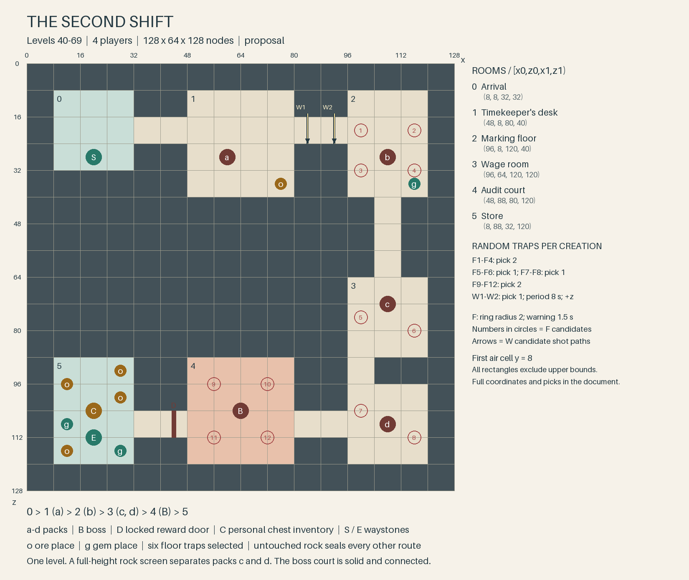

# The Second Shift — levels 40–69 Expedition

**Draft for decision, 2026-11-07; four players.** Build in Round 72 after the
Round 71 GUI test. [Concept §9](round71-expeditions-concept.md#9-after-the-build-three-expeditions-user-2026-11-07)
overrides the older outline and the range/tier lines in the
[built rules](../design/expeditions.md). **Compatible:** documents and drawing
tool only. Independent Opus review with whole replacement texts follows;
this draft is not approval to implement.

## Story and place

A guild crew broke into an old payroll working: lamps tended, benches
occupied, every name on the shift board belonging to someone dead.
**Auditor Nemm** pays them with branded battlefield coin. Each payment renews
a shift that death cannot end. The crew withdrew before accepting wages.

**The Accord's** Charter of Stone wants the workers' names freed from a
fraudulent account. **The Throng's** Oathdelvers will not let a paymaster buy
the dead's promises. Each guild acts independently. The Tithe-Brand appears
as a broken circle with two hooks; its creditor stays unnamed. This is one
stolen workforce, separate from the Undead people's old blight. No earlier
Expedition or story chapter is needed.

Use existing props, carts, pay benches and signs. One board reads
**“SECOND SHIFT / SAME NAMES / STILL DUE”**. No new item, model or story tunnel.

## Route and encounters

**0 → 1 → 2 → 3 → 4 → 5**, one floor; target **15 minutes at 40**: 8 for
packs, 3 for Nemm, 4 for travel/recovery/rewards, unmeasured. Balance for
**Warrior, Priest and two others** at the selected level, without requiring
particular talents. Players cap at 60; 61–69 is deliberately hard. Entry is
`min(run level − 2, 60)`; fewer players do not reduce encounters.

Use existing **Skeleton Raider** and **zombie/Buried Miner** families, present
through level 60. The Expedition levelling path extends those bodies through
69; normal names follow band data, Nemm keeps his name. Raiders shoot at
range and strike up close; retain the zombie family's racial behaviour.

| Room | Encounter | Role and movement task |
|---|---|---|
| **0 · Arrival** | Start waystone; no mobs or resources. | Prepare together. |
| **1 · Timekeeper's desk** | **a:** 2 normal raiders, 2 normal miners. | Warrior gathers miners; others focus one bow; Priest keeps a clear healing line. Ore beyond the pack. |
| **2 · Marking floor** | **b:** 2 normal raiders, 1 elite miner; 2 floor traps. | Warrior holds the elite; others clear bows; Priest moves between heals. Everyone leaves red rings. Gem at the far wall. |
| **3 · Wage room** | **c/d:** each 2 normal raiders, 1 elite miner, 1 floor trap. Rock screen between bays. | Pull one bay at a time. Warrior turns the elite slam away; Priest keeps sight; others leave the screen's bypass clear. |
| **4 · Audit court** | **Auditor Nemm**, one elite boss, alone; 2 floor traps. | Tank keeps Nemm close; healer follows in sight; others avoid the last marked spot. |
| **5 · Store** | Personal chest inventory, six mining places, end waystone. | Share mining, loot and return. |

**8 normal raiders, 2 normal miners, 3 elite miners, 1 boss.** Packs pull
whole and never give up; a wipe restores an unfinished pack, fully dead
packs stay dead. Death returns to room 0 with the normal penalty; the walk
back stays open. Sealed box far under the sea, no building/riding/flying;
only marked ore and gems can be dug.

## Traps and the boss

Traps **never notice or hurt mobs**. Choose candidates once per creation,
without replacement within each group; choices and revealed marks survive
wipes. Unchosen floor candidates are ordinary floor.

- **Floor:** **6 of 12**, grouped in the plan. Invisible trigger, muted red
  ring for **1.5 s**, strong damage, rearm **10 s after firing**, then visible
  for the run. Propose radius **0.6 trigger / 2 damage**, damage **45% of the
  run level's neutral HP pool** before ordinary mitigation. In occupied rooms,
  move the fight onto known clear floor instead of circling blindly.
- **Wall:** **1 of W1–W2**, every **8 s**, always, **+z** across the room 1–2
  passage. Visible fireball: speed **8**, height **y=8.5**, radius-2 burst on
  hitting a player, same proposed damage; stone stops it. No knockback or
  terrain damage. Wait in the cleared room, watch a shot pass, cross its line;
  do not bunch there. First shot on readiness, no targeting.

**Auditor Nemm** reuses the raider's body, bow and attacks, plus the existing
elite wind-up. Every **12 s of combat**, mark the current target's floor
position once and use the floor trap's **same 1.5 s ring and damage** there.
The Warrior moves without losing melee pressure; the group leaves the old
spot clear. **One position, one delayed hit** preserves the remembered blow;
no four-player history, replay, adds or new animation.

This is a boss attack using the trap helper, not another armed trap; its
ring ends with the hit. The six placed traps keep their normal rearm and
persistent marks. Cancel the pending hit on reset/death. Fallback: existing
attacks among the placed traps, whose revealed positions remember footsteps.

The **solid, connected 32 × 32 court is Nemm's range**. No passage pursuit or
safe ledge. A wipe or **15 s without an attack** heals and resets Nemm;
room traps cannot refresh that timer. His death opens the store, gives
participation credit through damage/healing and no ground loot.

## Ore and rewards

**Eight shared places:** ore after a, gem after b; four ore and two gems in
the store, all reachable from dry floor with solid backing. Preparation fills
**ore/gem markers** at **T4 for 40–49, T5 for 50–59, T6 for 60–69**; no named
mineral baked into the template. At T6 both labels may resolve to one resource.
Mobs/chest supply no raw ore or gems; retain the Expedition drop filter.

The chest behind Nemm gives a separate inventory to each eligible player,
including a member entering after the kill. Proposed starting payout follows
The Stilled Seam: **1 Uncommon item, 25% chance of 1 Rare item, a Bag of Coins
worth ten kill bags, 3–5 Heavy Cloth, 1–2 Linen Scrap**. Gear uses run level
and tier; the build checks income/XP before fixing amounts. End waystone
beside the chest; both waystones return to the departure capital. Return
Home follows its usual rules; both travel methods refuse combat.

## Optional quest: Party: The Second Shift

**Level 40**, opens at 38; once per character, free, group-marked; no
prerequisite, follow-up or `story` flag. **Kill Auditor Nemm (1)** at any run
level. Proposed level-40 XP/copper, weight 4; no reputation or essential item.
Entry/repeat runs need no quest.

Guild-house givers/turn-ins: **Alis Cartwright, Hadrin Beamset, Caelir
Veinward** for The Accord; **Drava Flintshoulder, Iven Lastshift, Ombali
Ropekeeper** for The Throng. Six capital variants of one quest, two faction
texts; return to the giver. Registrar handles entry. Each block is replaceable whole.

**The Accord — offer**

> Our crew found dead miners still at their benches. Auditor Nemm pays them in coin burned with a broken circle and two hooks. Each payment puts their names down for another shift. The Charter of Stone will not recognise that account. Ask this guild house's registrar for The Second Shift Expedition, take three companions, and kill Auditor Nemm.

**The Accord — completion**

> Auditor Nemm is dead. We can close that payroll and put the names on a memorial. The crew will leave the branded pay for people who can handle it safely. They asked whether the lost shifts should be entered as unpaid leave. I told them to enter the names, and stop counting.

**The Throng — offer**

> The crew found miners working who should have been resting in their graves. Auditor Nemm pays them with burned coin, and every payment buys another shift. The Oathdelvers never sold those names. Ask this guild house's registrar for The Second Shift Expedition, take three companions, and kill Auditor Nemm. No paymaster decides how long our dead must work.

**The Throng — completion**

> Auditor Nemm will call no more shifts. We will take the names off that payroll and remember them properly. Leave the burned pay for people who know how to handle it. The crew have offered to finish the abandoned working. This time, everyone comes home when the shift is done.

## Cost and open questions

Beyond the two shared traps: **small** template/roster/quest/loot work,
**small** Nemm adapter (one coordinate and delayed hit), **small** static
payroll dressing. No large system or custom art. Fallback: omit the adapter.
Room boundaries and the 15 s reset belong to Round 72's shared boss work.

- **Remembered blow:** recommend the single hit above; omit the old replay.
- **Tuning:** recommend the proposed trap values and eight mining places.
  Measure 40/49/50/59/60/69, starting with shipped boss HP scaling; adjust
  health before adding mechanics. Keep 61–69 hard.
- **GUI, desktop/web:** readable silent cues; tank/healer dodging; enough
  space for every selection; pack wipe, boss reset, death return, separate
  chest inventories. These checks remain the user's; none ran in this lane.

## Floor plan and build coordinates

Build constraints: game logic runs only on the server, with standard desktop
and web clients. Every cue works silently; no new sound. Budget the shared
traps at 16 particles per warning, 8 per impact, at most 8 live tail particles
per fireball. Persistent marks use the shared trap visual, not dense repeated
spawners; no lake-wide mist. Keep the complete encounter, player spells
included, in the hundreds of simultaneous particles.



All coordinates are **local node indices**; rectangles `[x0,z0,x1,z1)` exclude
upper bounds, as in the [built source](../../tools/expedition_templates/sources/stilled_seam.py).
Box `128 × 64 × 128`; first air cell **y=8**, solid floor at y=7; rooms clear
through y=18, court through y=22, passages through y=13. Decor stays against
walls; keep passages at least six nodes clear. Full-height screen
`[104,88,120,96)` leaves the eight-node bypass in room 3.
Room rectangles are printed on the image and stored in the generator.

| Places | Coordinates (x,z), in listed order |
|---|---|
| Pack anchors a / b / c / d; boss | (60,28) / (108,28) / (108,72) / (108,108); (64,104) |
| F1–F4; pick 2 | (100,20), (116,20), (100,32), (116,32) |
| F5–F6; pick 1; F7–F8; pick 1 | (100,76), (116,80); (100,104), (116,112) |
| F9–F12; pick 2 | (56,96), (72,96), (56,112), (72,112) |
| W1–W2; pick 1 | wall socket (84,15) or (92,15), +z to wall at z=24; crosses floor z=16–23 |
| Ore / gem on route | (76,36) / (116,36) |
| Store ore / gems | (12,96), (28,92), (28,100), (12,116) / (12,108), (28,116) |
| Start / arrival / chest / end | (20,28) / (20,24) / (20,104) / (20,112) |
| Reward door | x=44, z=104–111, y=8–13; marker (44,10,108) |
| Passages | [32,16,48,24), [80,16,96,24), [104,40,112,64), [80,104,96,112), [32,104,48,112) |

Wall muzzles sit just inside the passage at z=15.6, y=8.5; the socket
coordinates identify the wall, not a projectile spawned inside stone.

Pack anchors are centres, not piles of mobs: place the members 2–3 nodes
apart inside their bay, with clear headroom and no contact with the next
pack. Put mining nodes at y=9 on solid plinths; waystones/chest at y=8.

<!-- floorplan-grid:start -->
```text
################################
################################
##0.....####1.......####2.....##
##......####........#w#w......##
##............................##
##.......................f...f##
##......####........####......##
##...S..####...a....####...b..##
############........####.f...f##
############.......o####.....g##
##########################..####
##########################..####
##########################..####
##########################..####
##########################..####
##########################..####
########################3.....##
########################......##
########################...c..##
########################.f....##
########################.....f##
########################......##
##5.....####4.......####..######
##.....o####........####..######
##.o....####..f...f.####......##
##.....o####........####......##
##...C..........B........f....##
##.g.......D...............d..##
##...E..####..f...f.####.....f##
##.o...g####........####......##
################################
################################
```
<!-- floorplan-grid:end -->

One grid cell is **4 × 4 nodes**, sampled coarsely. `#` rock, `.` floor,
`0–5` rooms, `a–d` packs, `f/w` trap candidates, `o/g` mining places,
`B` boss, `D` door, `C` chest, `S/E` waystones. Image and coordinate table
resolve exact positions.

Regenerate both plans and the lake section with
`python3 tools/r72_rework/floorplan.py`; `--grid` prints both grids and
`--check` compares the three PNGs and embedded grids. Python 3 and Pillow.
Grounding: [guild](../design/miners_guild.md), [story](../design/story.md),
[story bible](round36/story-bible.md), [mobs](../design/biomes_mobs.md),
[classes](../design/classes.md), [quests](../design/quests.md).
